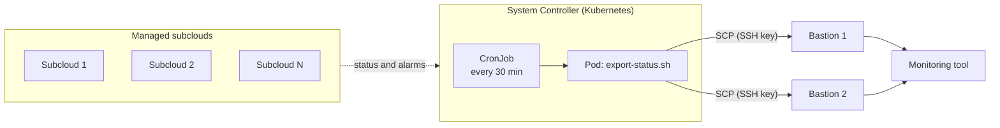

# StarlingX Status Exporter

A Kubernetes CronJob that periodically collects health and alarm status from a
[StarlingX](https://www.starlingx.io) Distributed Cloud **System Controller**, writes it to
JSON files, and copies them over SCP to one or more **bastion hosts**, where an external
monitoring or assurance tool picks them up.

Use it when a monitoring tool needs a periodic, file-based status feed from a distributed
cloud and cannot (or should not) call the StarlingX APIs directly.

## How it works



Each run, the pod:

1. Requests a Keystone token with a dedicated API user.
2. Calls four StarlingX APIs and saves each response as JSON.
3. Copies the files to every bastion host with SCP using key-based SSH (no SSH password).
4. Exits non-zero if any copy fails, so the failure is visible in the Job status.

| API | Endpoint | Output file |
|---|---|---|
| dcmanager, subclouds | `:8119/v1.0/subclouds` | `subclouds_status_<ts>.json` |
| dcmanager, alarm summary | `:8119/v1.0/alarms` | `subclouds_alarms_<ts>.json` |
| Fault management | `:18002/v1/alarms` | `system_controller_alarms_<ts>.json` |
| sysinv, hosts | `:6385/v1/ihosts` | `system_controller_hosts_<ts>.json` |

API references: [dcmanager](https://docs.starlingx.io/api-ref/distcloud/api-ref-dcmanager-v1.html),
[sysinv](https://docs.starlingx.io/api-ref/metal/api-ref-sysinv-v1-metal.html).

## Repository layout

```
docker/Dockerfile              Minimal Alpine image (curl, jq, openssh-client)
scripts/export-status.sh       Collection and copy script
k8s/cronjob.yaml               CronJob manifest
k8s/configmap.example.yaml     Settings template (hosts, user, paths)
```

## Prerequisites

- A StarlingX Distributed Cloud System Controller with `kubectl` access.
- A machine with Docker to build the image (or use your CI).
- One or more bastion hosts where the exporter's public key can be added.
- A registry the System Controller can pull from (the local registry works for labs).

## Setup

All commands below use placeholder values (`192.0.2.x` is a documentation range). Replace them.

### 1. Build and publish the image

```bash
docker build -t status-exporter -f docker/Dockerfile .
docker save -o status-exporter.tar status-exporter:latest
scp status-exporter.tar sysadmin@<system-controller-oam-vip>:~
```

On the System Controller:

```bash
sudo docker load -i status-exporter.tar
sudo docker tag status-exporter:latest registry.local:9001/docker.io/library/status-exporter:latest
sudo docker push registry.local:9001/docker.io/library/status-exporter:latest
```

In production, push to your own registry instead and update `image:` in `k8s/cronjob.yaml`.

### 2. Create an SSH key pair

On the active controller:

```bash
ssh-keygen -t ed25519 -f ./id_rsa -N "" -C "status-exporter"
```

Add `id_rsa.pub` to `~/.ssh/authorized_keys` of the SSH user on **each** bastion host:

```bash
mkdir -p ~/.ssh && chmod 700 ~/.ssh
cat id_rsa.pub >> ~/.ssh/authorized_keys
chmod 600 ~/.ssh/authorized_keys
```

### 3. Create a dedicated API user

Create a service user (for example `status-exporter`) with a strong password and the `admin`
role on the `admin` project, via Horizon (Identity, Users) or the CLI. Use an account that is
exempt from your password-rotation policy, otherwise the job will start failing when the
password changes.

### 4. Create the Secrets and ConfigMap

Create the secrets from the command line so credentials never land in a file or in git:

```bash
kubectl create secret generic status-exporter-api \
  --from-literal=username='status-exporter' \
  --from-literal=password='<strong-password>'

kubectl create secret generic status-exporter-ssh \
  --from-file=id_rsa=./id_rsa

cp k8s/configmap.example.yaml k8s/configmap.yaml
# edit DC_HOST, BASTION_HOSTS, DEST_USER, DEST_DIR
kubectl apply -f k8s/configmap.yaml
```

### 5. Deploy the CronJob

```bash
kubectl apply -f k8s/cronjob.yaml
kubectl get cronjobs
```

## Validate

On the System Controller:

```bash
kubectl get cronjobs
kubectl get pods
kubectl logs <pod-name>
```

To test immediately instead of waiting for the schedule:

```bash
kubectl create job --from=cronjob/status-exporter status-exporter-test
kubectl logs job/status-exporter-test
```

On each bastion host, confirm that new `*.json` files appear in the destination directory.

## Configuration

| Variable | Required | Description |
|---|---|---|
| `DC_HOST` | yes | System Controller OAM IP or FQDN |
| `API_USERNAME`, `API_PASSWORD` | yes | From the `status-exporter-api` Secret |
| `BASTION_HOSTS` | yes | Space-separated bastion hosts |
| `DEST_USER` | yes | SSH user on the bastion hosts |
| `DEST_DIR` | no | Remote directory (default `/var/tmp`) |
| `SSH_KEY` | no | Private key path (default `/etc/exporter/ssh/id_rsa`) |
| `CA_CERT` | no | CA bundle for API TLS verification |

The schedule is set in `k8s/cronjob.yaml` (`*/30 * * * *`).

## Security notes

- **No credentials in the image, script or manifests.** API credentials and the SSH private key
  are Kubernetes Secrets. Do not commit `secret*.yaml` files; `.gitignore` excludes them.
- **TLS:** StarlingX uses self-signed certificates by default, so without `CA_CERT` the script
  skips certificate verification (and logs a warning). For production, mount your CA and set `CA_CERT`.
- **Host keys:** the script trusts bastion host keys on first use (`ssh-keyscan`). Pre-populate
  `known_hosts` if you need stricter checking.
- **Least privilege:** the API user needs read access only in principle, but the Keystone token
  is scoped to the `admin` project in this design. Review that against your own policy.
- **De-duplication:** with two bastions, the same files arrive on both. The consuming tool must
  de-duplicate.

## Troubleshooting

| Symptom | Check |
|---|---|
| `could not obtain an API token` | Credentials, `DC_HOST`, port 5000 reachable from the pod |
| `Permission denied (publickey)` | Public key in the bastion user's `authorized_keys`; correct `DEST_USER` |
| `ImagePullBackOff` | Image tag in `cronjob.yaml`, registry login, `imagePullSecrets` |
| No files on the bastion | `kubectl logs` for the last pod; destination directory exists and is writable |
| Job runs every minute | Check the cron expression; `*/30 * * * *` runs every 30 minutes |

## Limitations

- Output is raw API JSON; any translation for a dashboard is done by the consuming tool.
- The scratch directory is deleted after each run, so nothing accumulates in the pod.

## License

MIT, see [LICENSE](LICENSE).
